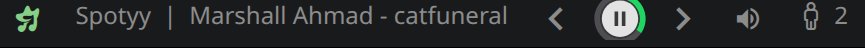
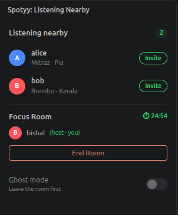

# Spotyy for VS Code

Spotify controls in your status bar, plus a **local-network team music layer**: see what teammates on the same Wi-Fi are listening to, get vibe-match highlights, and focus together in Focus Rooms.

Works in **VS Code, Cursor, Windsurf, VSCodium** and other VS Code–based editors. It interoperates with the [Spotyy JetBrains plugin](https://plugins.jetbrains.com/plugin/com.github.magneto3572.spotyy), so IntelliJ and VS Code users on the same network see each other and can share Focus Rooms.





## Features

- **Playback controls**: previous / play-pause / next, now-playing track and volume in the status bar, with a live progress ring around the play button (same look as the JetBrains plugin)
- **Listening nearby**: a sidebar view of teammates on your LAN and what they're playing
- **Vibe match**: highlights when you and a teammate play the same song (✦) or the same artist (∼)
- **Focus Rooms**: start a 25 / 45 / 60 minute shared countdown and invite teammates; the host can remove members
- **Ghost mode**: stop broadcasting what you listen to

## Requirements

- The **Spotify desktop app** (the web player isn't supported)
- **macOS**: uses AppleScript. On first use, allow your editor to control Spotify in *System Settings → Privacy & Security → Automation*.
- **Linux**: uses MPRIS over D-Bus. Installing `playerctl` is recommended. Snap-packaged Spotify blocks D-Bus access; use the official `.deb`.
- **Windows**: not supported yet (controls are no-ops).
- Team features need everyone on the **same subnet**, with UDP port **57372** open for broadcasts.

## Commands

All commands are under **Spotyy:** in the Command Palette: Play / Pause, Next Track, Previous Track, Volume Up/Down, Set Volume…, Show Listening Nearby, Toggle Ghost Mode, Start Focus Room…, Leave Focus Room.

## Settings

| Setting | Default | Description |
|---|---|---|
| `spotyy.statusBar.maxTrackLength` | `40` | Max characters of the track name in the status bar |
| `spotyy.statusBar.showVolume` | `true` | Show the volume item |

## Privacy

Spotyy broadcasts your OS username and current track over UDP to your local subnet only. Nothing is sent to the internet. Turn on Ghost mode to stop broadcasting.

## Development

```bash
npm install
npm run build        # bundle to dist/extension.js
npm test             # protocol/unit tests
npm run package      # produce spotyy-x.y.z.vsix
npm run icons        # rebuild media/spotyy-icons.woff (needs: python3 -m pip install fonttools)
```

Press F5 from the `vscode/` folder (with `.vscode/launch.json`) to launch an Extension Development Host.
